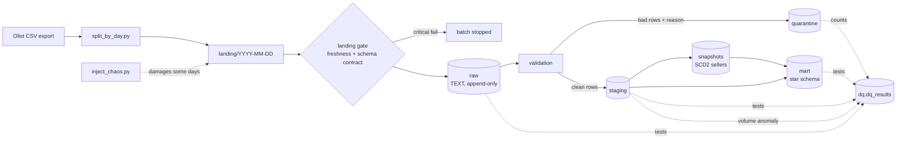

# Merchant Data Pipeline with Layered Data Quality

**Trustworthy data, and proof that it is.**

A daily batch pipeline for marketplace transactions (merchants, orders, payments) built on
**Airflow + dbt + PostgreSQL**, with data quality checks at every layer, a quarantine for bad rows,
and an SCD Type 2 merchant dimension. To prove the checks work, the pipeline deliberately damages
some daily batches and then verifies that **every injected defect was detected**.

> Status: core pipeline, star schema, SCD2 and data quality are done and verified.
> Airflow DAG, monitoring dashboard and CI are in progress.

---

## Why this project

Most pipeline demos show data flowing. This one focuses on the question a data team actually
gets asked: *"Can we trust yesterday's numbers?"* Every batch produces a DQ record that answers it.

## Architecture



| Layer | What it holds | Rule |
|---|---|---|
| `landing/` | One folder of CSVs per day + `_SUCCESS` marker | Must exist and match the data contract, or the batch stops |
| `raw` | Exact copy of the files, all columns `TEXT`, plus `_batch_date`, `_source_file`, `_loaded_at` | Never rejects a value, so a bad value is recorded instead of crashing the load |
| `quarantine` | Rows that failed validation, with `_dq_reason` | Nothing is silently dropped |
| `staging` | Clean, typed, deduplicated rows (incremental, one batch per run) | All tests must pass |
| `snapshots` | SCD Type 2 history of sellers | One current version per seller, no overlaps |
| `mart` | Star schema + daily seller mart | Every fact resolves to its dimensions |

## Data quality: three levels

| Level | Example | What happens |
|---|---|---|
| **Batch** (critical) | folder missing, column dropped | landing gate stops the batch before anything is loaded |
| **Row** (warning) | null key, duplicate, negative amount, unknown category, orphan seller | raw tests record it, row goes to quarantine, batch continues |
| **Model** (critical) | fact without a seller version, two current SCD2 rows | dbt test fails, pipeline stops |
| **Aggregate** (warning) | today's order volume is 4× normal | robust z-score on log volume vs 7-day median |
| **Consistency** (warning) | payments ≠ item price + freight | reconciliation test per batch |

Every check writes one row to `dq.dq_results` (`batch_date, layer, target, check_name, severity,
status, failed_rows, details`), so the health of any day is one query away.

## Chaos: proving the checks work

`inject_chaos.py` damages nine days of the August 2018 replay; `verify_chaos.py` checks that each
defect was caught by the check that should catch it.

| Date | Injected defect | Expected detection |
|---|---|---|
| 08-02 | 5 duplicate orders, 5 duplicate items | `unique` tests on raw + quarantine `duplicate` |
| 08-04 | blank `customer_id` / `seller_id` | `not_null` on raw + quarantine `missing_*` |
| 08-06 | negative payments, unknown payment type | value-domain tests + quarantine |
| 08-08 | items pointing to unknown sellers | `relationships` on raw + quarantine `orphan_seller` |
| 08-10 | 5 sellers relocate (legit change) | 2 SCD2 versions each; later sales use the new version |
| 08-13 | the day delivered 4 times with new IDs (every row valid) | volume anomaly |
| 08-15 | `payments.csv` loses a column | schema contract: batch stopped |
| 08-17 | batch never arrives | freshness: batch stopped |
| 08-19 | wrong timestamp format, `R$ 59.90` as price | format tests + quarantine |

Result: **21/21 expected detections, 5/5 SCD2 relocations correct**, full report in
[`docs/chaos_report.md`](docs/chaos_report.md). The report also lists every other non-passing check:
knock-on effects (items whose product or seller was in a blocked batch wait in quarantine as
`orphan_product` / `orphan_seller` instead of breaking the star schema) and findings on the real data.

**Findings on the real data, not injected:** ~0.25% of orders don't reconcile (payments vs.
price + freight, mostly installment interest), and the source export is truncated after
2018-08-23: the volume check flags the drop on 08-24.

## Star schema

- `fact_order_items`: one row per item; `price`, `freight_value`, `item_total`
- `fact_payments`: one row per payment record of an order
- `dim_seller` (**SCD Type 2**): facts join to the version valid at purchase time
- `dim_customer` (SCD1, per real person), `dim_product`, `dim_date`
- `mart_seller_daily`: daily GMV per seller with `LAG`, running total and rank within state

## Run it

Requirements: Docker (≈4 GB RAM free) and the
[Olist dataset](https://www.kaggle.com/datasets/olistbr/brazilian-ecommerce) (free Kaggle account).

```bash
cp .env.example .env
# put the 6 Olist CSVs listed in data/source/README.md into data/source/
docker compose up -d --build            # Airflow UI: http://localhost:8080
make bootstrap                          # schemas, landing batches + chaos, initial load
make backfill START=2018-08-01 END=2018-08-28
make verify                             # writes docs/chaos_report.md
make idempotency DATE=2018-08-02        # re-run a day, prove no table changed
make psql                               # explore the warehouse
```

Without `make`: `docker compose exec airflow-scheduler bash scripts/bootstrap.sh --reset`, and so on
(see the `Makefile`).

Some useful queries:

```sql
-- health of every batch
select batch_date, count(*) filter (where status = 'fail' and severity = 'critical') as critical,
       count(*) filter (where status = 'fail' and severity = 'warning') as warnings
from dq.v_latest_results group by 1 order by 1;

-- what was quarantined, and why
select _batch_date, _dq_reason, count(*) from quarantine.order_items group by 1, 2 order by 1;

-- a relocated seller's history
select seller_id, seller_state, valid_from, valid_to, is_current from mart.dim_seller
where seller_id in (select seller_id from mart.dim_seller where version_number = 2);
```

## Design decisions

- **Raw is all TEXT.** Casting at load time turns one bad value into a failed load. Loading as text
  keeps the evidence and lets validation decide.
- **Quarantine instead of drop or fail.** Bad rows are kept with a reason; good rows keep flowing.
  Only batch-level or model-level problems stop the pipeline.
- **Idempotent by batch.** Raw loads delete-then-insert by `_batch_date`; incremental models use
  `delete+insert` on the natural key. Re-running a day gives the same result
  ([`docs/idempotency_check.txt`](docs/idempotency_check.txt): 26 tables, identical row counts).
  Re-running an *old* day never overwrites a seller with an older state.
- **SCD2 on business time.** The snapshot uses the batch date as `updated_at`, so a version starts
  on the day of the change, not when the pipeline happened to run.
- **Robust volume check.** Log scale (changes are multiplicative), median/MAD (one past spike doesn't
  poison the baseline), plus a materiality guard (ratio outside 0.5–2.0) to avoid noisy alerts.

## Project layout

```
airflow/dags/          Airflow DAG (in progress)
dbt/                   models (raw sources, staging, quarantine, marts), snapshot, tests, macros
ingestion/             split, landing gate, raw loader, DQ collector, volume check, chaos + verify
scripts/               run_batch.sh, backfill.sh, bootstrap.sh, crontab.example
sql/ddl/               raw and dq schemas
tests/                 unit tests (pytest)
docker/                Airflow image, Postgres init
```

## Data

[Brazilian E-Commerce Public Dataset by Olist](https://www.kaggle.com/datasets/olistbr/brazilian-ecommerce),
licensed CC BY-NC-SA 4.0. Not redistributed in this repository.
