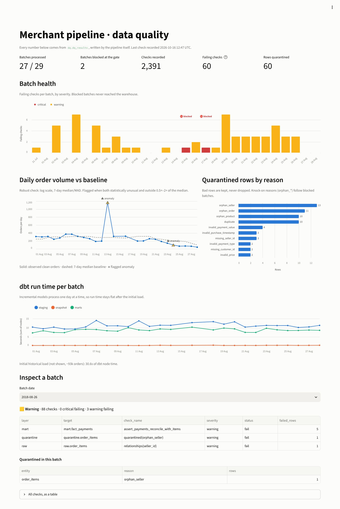
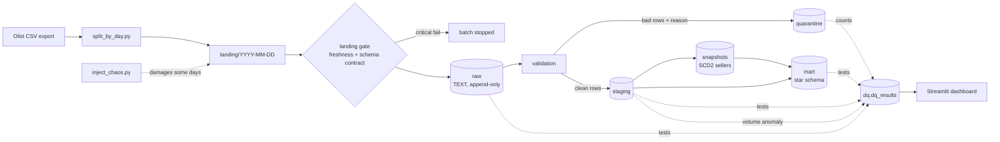

# Merchant Data Pipeline with Layered Data Quality

[](https://github.com/Yombia/merchant-dq-pipeline/actions/workflows/ci.yml)

**Trustworthy data, and proof that it is.**

A daily batch pipeline for marketplace transactions (merchants, orders, payments) on
**Airflow 3 + dbt + PostgreSQL**, with data quality checks at every layer, a quarantine for bad
rows, an SCD Type 2 merchant dimension and a monitoring dashboard. To prove the checks work,
the pipeline deliberately damages some daily batches and then verifies that
**every injected defect was detected**, locally and in CI on every push.



## What it proves

| Claim | Evidence |
|---|---|
| Every injected defect is caught by the check meant to catch it | **21/21** detections, [`docs/chaos_report.md`](docs/chaos_report.md) |
| Merchant history is kept correctly (SCD Type 2) | **5/5** relocated sellers: 2 versions each, later sales use the new version |
| Bad batches are stopped, bad rows are isolated, good rows keep flowing | 2 of 29 batches blocked at the gate, 60 rows quarantined with a reason, the other 27 loaded |
| Re-running a day changes nothing (idempotent) | 26 tables, identical row counts, [`docs/idempotency_check.txt`](docs/idempotency_check.txt) |
| Indexes are chosen from real query plans | up to **41×** faster daily upsert, [`docs/performance.md`](docs/performance.md) |
| It all runs unattended | Airflow DAG with catchup; GitHub Actions runs the full pipeline + chaos on every push |

---

## Architecture



| Layer | What it holds | Rule |
|---|---|---|
| `landing/` | One folder of CSVs per day + `_SUCCESS` marker | Must exist and match the data contract, or the batch stops |
| `raw` | Exact copy of the files, all columns `TEXT`, plus `_batch_date`, `_source_file`, `_loaded_at` | Never rejects a value, so a bad value is recorded instead of crashing the load |
| `quarantine` | Rows that failed validation, with `_dq_reason` | Nothing is silently dropped |
| `staging` | Clean, typed, deduplicated rows (incremental, one batch per run) | All tests must pass |
| `snapshots` | SCD Type 2 history of sellers | One current version per seller, no overlaps |
| `mart` | Star schema + daily seller mart | Every fact resolves to its dimensions |

## Orchestration: the `merchant_daily` DAG

```
check_landing → load_raw → dbt_staging → dbt_snapshot → dbt_marts → collect_dq → done
                                └─────→ volume_anomaly ───────────────────────────┘
```

- One run = one batch date. `catchup` replays 2018-07-31 (initial load) to 2018-08-28.
- `max_active_runs=1`: runs are strictly in order, because SCD2 history and volume baselines
  depend on it. `depends_on_past=False`: a blocked day does not block the next one, like a real feed.
- `collect_dq` uses `trigger_rule=all_done`, so DQ evidence is recorded even when a dbt step fails;
  it marks itself *skipped* when the landing gate blocked the batch (nothing to collect).
- `done` (`all_success`) gives each run its verdict. `retries=0`: a DQ failure is a finding, not a
  flaky error.
- The same steps run without Airflow via `scripts/run_batch.sh`, so the logic is not tied to the
  orchestrator.

## Data quality

| Level | Example | What happens |
|---|---|---|
| **Batch** (critical) | folder missing, column dropped | landing gate stops the batch before anything is loaded |
| **Row** (warning) | null key, duplicate, negative amount, unknown category, orphan seller/product | raw tests record it, the row goes to quarantine, the batch continues |
| **Model** (critical) | fact without a seller version, two current SCD2 rows | dbt test fails, the run fails |
| **Aggregate** (warning) | today's order volume is 4× normal | robust z-score on log volume vs 7-day median |
| **Consistency** (warning) | payments ≠ item price + freight | reconciliation test per batch |

Every check writes one row to `dq.dq_results` (`batch_date, layer, target, check_name, severity,
status, failed_rows, details`); dbt node timings go to `dq.dbt_node_runs`. The dashboard and the
verification script read only these tables, so they can never disagree with the pipeline.

### Chaos: proving the checks work

| Date | Injected defect | Expected detection |
|---|---|---|
| 08-02 | 5 duplicate orders, 5 duplicate items | `unique` tests on raw + quarantine `duplicate` |
| 08-04 | blank `customer_id` / `seller_id` | `not_null` on raw + quarantine `missing_*` |
| 08-06 | negative payments, unknown payment type | value-domain tests + quarantine |
| 08-08 | items pointing to unknown sellers | `relationships` on raw + quarantine `orphan_seller` |
| 08-10 | 5 sellers relocate (legit change) | 2 SCD2 versions each; later sales use the new version |
| 08-13 | the day delivered 4 times with new IDs (every row valid) | volume anomaly |
| 08-15 | `payments.csv` loses a column | schema contract: batch stopped |
| 08-17 | batch never arrives | freshness: batch stopped |
| 08-19 | wrong timestamp format, `R$ 59.90` as price | format tests + quarantine |

The report also lists every other non-passing check, so nothing is hidden: knock-on effects (items
whose seller or product was in a blocked batch wait in quarantine as `orphan_*` instead of breaking
the star schema) and findings on the real data.

**Findings on the real data, not injected:** ~0.24% of orders don't reconcile (payments vs.
price + freight, mostly installment interest), and the source export is truncated after
2018-08-23: the volume check flags the drop on 08-24.

## Star schema

- `fact_order_items`: one row per item; `price`, `freight_value`, `item_total`
- `fact_payments`: one row per payment record of an order
- `dim_seller` (**SCD Type 2**): facts join to the version valid at purchase time
- `dim_customer` (SCD1, per real person), `dim_product`, `dim_date`
- `mart_seller_daily`: daily GMV per seller with `LAG`, running total and rank within state

## CI

[`.github/workflows/ci.yml`](.github/workflows/ci.yml), on every push:

1. **Lint + unit tests**: ruff, pytest (landing gate, volume check, chaos generators, batch split).
2. **DAG integrity**: installs Airflow 3.2.2 with the official constraints, loads the DAG and checks
   schedule, catchup, task order and trigger rules.
3. **End-to-end**: Postgres service container, a synthetic Olist-shaped dataset
   ([`tests/fixtures/make_fixture.py`](tests/fixtures/make_fixture.py)), bootstrap, 28-day replay,
   then asserts that exactly the two sabotaged days were blocked, that all 21 defects were detected,
   and that re-running a day changes nothing. Uploads the chaos report and dbt docs as artifacts.

## Run it

Requirements: Docker with ~6 GB RAM available and the
[Olist dataset](https://www.kaggle.com/datasets/olistbr/brazilian-ecommerce) (free Kaggle account).

```bash
cp .env.example .env
# put the 6 Olist CSVs listed in data/source/README.md into data/source/
docker compose up -d --build
#   Airflow:   http://localhost:8080
#   Dashboard: http://localhost:8501
```

**With Airflow (the real thing):**

```bash
make prepare        # clean warehouse, landing batches + chaos (no load yet)
# in the Airflow UI: unpause "merchant_daily" -> it replays 2018-07-31..2018-08-28 in order
make verify         # after the runs finish: writes docs/chaos_report.md
```

**Without Airflow (same steps, from the shell):**

```bash
make bootstrap                                  # prepare + initial load
make backfill START=2018-08-01 END=2018-08-28
make verify
make idempotency DATE=2018-08-02
make benchmark                                  # writes docs/performance.md
```

No `make` (e.g. Windows): run the command shown in the `Makefile`, for example
`docker compose exec airflow-scheduler bash scripts/bootstrap.sh --reset --prepare-only`.

Useful queries (`make psql`):

```sql
-- health of every batch
select batch_date, count(*) filter (where status = 'fail' and severity = 'critical') as critical,
       count(*) filter (where status = 'fail' and severity = 'warning') as warnings
from dq.v_latest_results group by 1 order by 1;

-- what was quarantined, and why
select _batch_date, _dq_reason, count(*) from quarantine.order_items group by 1, 2 order by 1;

-- a relocated seller's history
select seller_id, seller_state, valid_from, valid_to, is_current from mart.dim_seller
where seller_id in (select seller_id from mart.dim_seller where version_number = 2);
```

## Design decisions

- **Raw is all TEXT.** Casting at load time turns one bad value into a failed load. Loading as text
  keeps the evidence and lets validation decide.
- **Quarantine instead of drop or fail.** Bad rows are kept with a reason; good rows keep flowing.
  Only batch-level or model-level problems stop the pipeline.
- **Idempotent by batch.** Raw loads delete-then-insert by `_batch_date`; incremental models use
  `delete+insert` on the natural key; quarantine clears the batch first. Re-running an *old* day
  never overwrites a seller with an older state. `--full-refresh` is disabled on incremental models:
  the rebuild path is replaying batches.
- **SCD2 on business time.** The snapshot uses the batch date as `updated_at`, so a version starts
  on the day of the change, not when the pipeline happened to run.
- **Robust volume check.** Log scale (changes are multiplicative), median/MAD (one past spike doesn't
  poison the baseline), plus a materiality guard (ratio outside 0.5–2.0) to avoid noisy alerts.
  Known limit: a slow decline is absorbed by the rolling baseline after the first flagged day.
- **Indexes from query plans.** Created by dbt `post_hook`s on the keys the daily upsert and the
  common lookups use; measured before/after in [`docs/performance.md`](docs/performance.md).

## Project layout

```
airflow/dags/          merchant_daily DAG
dbt/                   sources, validation, quarantine, staging, snapshot, marts, tests, macros
ingestion/             split, landing gate, raw loader, DQ collector, volume check,
                       chaos + verification, idempotency check, benchmark
dashboard/             Streamlit DQ dashboard
scripts/               run_batch.sh, backfill.sh, bootstrap.sh, crontab.example
sql/ddl/               raw and dq schemas
tests/                 unit + DAG tests, synthetic data generator for CI
docker/                Airflow image (dbt in its own venv), dashboard image, Postgres init
.github/workflows/     CI
```

## Data

[Brazilian E-Commerce Public Dataset by Olist](https://www.kaggle.com/datasets/olistbr/brazilian-ecommerce),
licensed CC BY-NC-SA 4.0. Not redistributed in this repository; CI uses synthetic data of the same shape.
